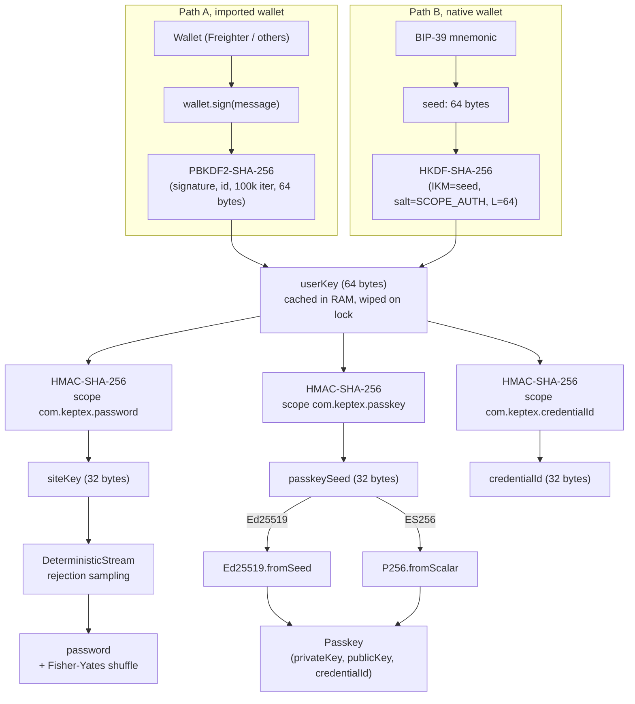

# Keptex Engine

**Reference implementation of the Keptex deterministic credential derivation engine.**

Keptex derives passwords and WebAuthn passkeys on demand from a cryptographic
wallet signature. Nothing is stored, nothing is synced: connect the same wallet
on a new device and every credential reappears. The wallet is the only secret in
the system.

This repository contains the **derivation engine only**: the pure algorithm that
turns a wallet signature into a per-service password or a per-site passkey. It is
the trust layer of the project, so we keep it small, dependency-light, and
re-implementable in any language, with public test vectors anyone can verify.

> **Project status: early, in active development.** The engine in this repository
> is implemented and unit-tested, but Keptex as a product is still being built.
> The user-facing applications, the encrypted vault, wallet integrations, cross-device
> flows, and an independent security audit are all in progress and are **not** part
> of this repository yet. See [Roadmap](#roadmap) below for what remains.

---

## What this repository is

A formal, source-available derivation algorithm with a written specification
([ALGORITHM.md](ALGORITHM.md)) and public test vectors.

It is **one engine with two derivation outputs**, both built on the same shared
base: the 64-byte `userKey` derived from a wallet signature, the `Signer` interface,
and the shared types.

- **Password derivation** lives in `@keptex/core`, which also carries that shared
  base. Zero runtime dependency, Web Crypto only.
- **Passkey derivation** lives in `@keptex/passkey` (Ed25519 and ES256), built on
  the same base. Adds one audited dependency, `@noble/curves`.

They are split into two packages only so `@keptex/core` can stay dependency-free:
the passkey curve operations are the one thing Web Crypto cannot do portably.

## What this repository is not

- Not a finished product. There is no installable application here, no user
  interface, no vault, and no sync.
- Not a wallet. The engine consumes a `Signer` interface; it does not manage keys,
  hold balances, or sign blockchain transactions.
- Not yet audited. The algorithm is documented and reproducible from the test
  vectors, but no independent security firm has reviewed it. An external audit is
  the top priority once the engine stabilises.

---

## How it works (one paragraph)

The user connects a wallet and signs one fixed, scoped message. The signature is
run through PBKDF2 (for imported wallets) or HKDF over a BIP-39 seed (for native
wallets) to produce a 64-byte `userKey`, held in RAM for the session and never
persisted. For each service, an HMAC-SHA-256 of the `userKey` with a per-service
scope produces a 32-byte `siteKey`, from which a password is materialised through
a rejection-sampled deterministic stream (no modulo bias). For each WebAuthn
relying party, an analogous HMAC produces a seed from which an Ed25519 or ES256
keypair is derived per use. No private key material is ever stored. The full
specification, including the exact byte layout of every step, is in
[ALGORITHM.md](ALGORITHM.md).

---

## Stellar synergy

Keptex is Stellar-first by design. Stellar accounts are natively **Ed25519**, and
WebAuthn passkeys support Ed25519 (COSE algorithm `-8`). When a relying party
accepts it, Keptex runs the **same curve from the wallet to the passkey**: the
Stellar key that anchors a user's identity and the passkey that logs them into a
website share one cryptographic family, end to end.

Imported Stellar wallets (Freighter, xBull, Albedo, Rabet) plug in through the
`Signer` interface. A Keptex-native wallet also derives a Stellar address
(SLIP-0010 `m/44'/148'`) from a single BIP-39 seed, so one seed backs the identity
and every derived credential.

---

## How it works (diagram)



Everything down to `userKey`, plus the password branch, is `@keptex/core`. The
passkey branch (Ed25519 / ES256 to COSE) is `@keptex/passkey`. Both consume the same
`userKey`.

---

## Packages

Two packages, one engine. `@keptex/core` holds the shared base (`userKey`, `Signer`,
types) plus password derivation; `@keptex/passkey` is its peer, deriving passkeys on
that same base.

| Package | Role | Runtime dependencies | Licence |
|---|---|---|---|
| `@keptex/core` | Shared base (`userKey` + `Signer` + types) + **password** derivation | none (Web Crypto only) | PolyForm NC |
| `@keptex/passkey` | **Passkey** derivation (Ed25519 / ES256, COSE), on the shared base | `@noble/curves` | PolyForm NC |

## Quick start

```bash
pnpm install
pnpm test          # runs the unit tests and verifies the published vectors
```

```ts
import { deriveUserKey, derivePasswordFromUserKey } from '@keptex/core'

const userKey = await deriveUserKey(signer)            // one wallet signature
const { password } = await derivePasswordFromUserKey(userKey, {
  service: 'github.com',
  username: 'alice@example.com',
})
```

Verify the engine against the published vectors at any time:

```bash
pnpm --filter @keptex/core test
```

For a vector-by-vector walk-through (inputs, intermediate values, expected output),
see [TEST-VECTORS.md](TEST-VECTORS.md).

---

## Roadmap

The derivation engine is the foundation. The work that remains to turn it into a
shippable product is substantial and is tracked privately, but the broad strokes:

- **Independent security audit** of the engine and its consumers.
- **Productionisation**: key-at-rest handling, hardening, attestation, conformance.
- **Encrypted vault** for the (non-secret) service metadata.
- **User-facing surfaces**: browser extension, desktop, and mobile applications.
- **Wallet integrations** across the Stellar ecosystem (Stellar Wallets Kit, Freighter, and more).
- **Distribution**: store submissions, signed artefacts, reproducible builds.

Contributions and security review of the engine itself (`@keptex/core`,
`@keptex/passkey`) are especially welcome at this stage. See
[CONTRIBUTING.md](CONTRIBUTING.md) and [SECURITY.md](SECURITY.md).

---

## Licence

This repository is **source-available, not open source**. It is licensed under the
[PolyForm Noncommercial License 1.0.0](LICENSE): you may read, audit, modify, and
use it for any noncommercial purpose. **Commercial use, including embedding it in a
wallet or any product offered to users, requires a separate agreement.** See
[INTEGRATION.md](INTEGRATION.md) to get in touch.

The code is public so it can be audited; the algorithm is the trust layer of Keptex
and must be verifiable and re-implementable from the specification and test vectors.
