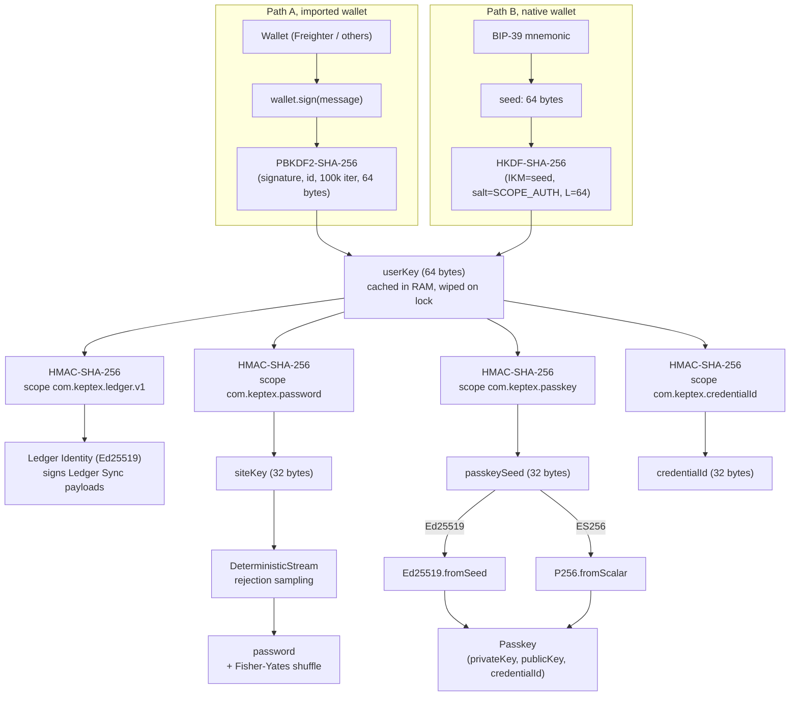

# Keptex Engine

**Reference implementation of the Keptex deterministic credential derivation engine.**

Keptex derives passwords and WebAuthn passkeys on demand from a cryptographic
wallet signature. Nothing is stored, nothing is synced: connect the same wallet
on a new device and every credential reappears. The wallet is the only secret in
the system.

This repository contains the **derivation engine**: the pure algorithm that turns
a wallet signature into a per-service password or a per-site passkey, and the
Stellar layer built on it: a verified SEP-53 root for Stellar wallets and the
client side of Ledger Sync, an optional encrypted metadata sync through a Soroban
contract. It is the trust layer of the project, so we keep it small,
dependency-light, and re-implementable in any language, with public test vectors
anyone can verify.

> **Project status: early, in active development.** The packages in this
> repository are implemented and unit-tested, but Keptex as a product is still
> being built. The user-facing applications, the encrypted vault, the wallet
> connectors, the sync relayer and a third-party security audit are **not** part
> of this repository. Nothing is deployed on a Stellar network yet and Keptex has
> no users yet. See [Roadmap](#roadmap) below for what remains.

---

## What this repository is

A formal, source-available derivation algorithm with a written specification
([ALGORITHM.md](ALGORITHM.md)) and public test vectors.

It is **one engine with two derivation outputs**, both built on the same shared
base: the 64-byte `userKey` derived from a wallet signature, the `Signer` interface,
and the shared types.

- **Password derivation** lives in `@keptex/core`, which also carries that shared
  base and the optional second-factor mode. Zero runtime dependency, Web Crypto
  only.
- **Passkey derivation** lives in `@keptex/passkey` (Ed25519 and ES256), built on
  the same base. Adds one audited dependency, `@noble/curves`.

They are split into two packages only so `@keptex/core` can stay dependency-free:
the passkey curve operations are the one thing Web Crypto cannot do portably.

Two packages add the Stellar layer, specified in
[docs/LEDGER-SYNC.md](docs/LEDGER-SYNC.md) and in section 12 of
[ALGORITHM.md](ALGORITHM.md):

- **`@keptex/stellar-root`** turns a Stellar wallet or signing provider into the
  engine's signer, and only hands over a SEP-53 signature that verifies under the
  connected address (with the strict Ed25519 rules of the Soroban host) and that
  stays the same from one session to the next.
- **`@keptex/ledger-sync`** derives the Ledger Identity from `userKey`, builds and
  signs the payloads of the KeptexSyncRegistry contract and seals the encrypted
  sync envelope. The contract itself is in
  [Keptex/sync-registry](https://github.com/Keptex/sync-registry). What is
  written to a blockchain is permanent, older versions included, so Ledger Sync
  is meant only for vaults in the second-factor mode with a random secret key:
  there the wallet key alone, stolen or recovered, opens no block. It is not
  offered without a second factor, and refused when the secret comes from a
  master password. `syncPolicy` gives clients that verdict
  ([docs/LEDGER-SYNC.md](docs/LEDGER-SYNC.md), section 9).

## What this repository is not

- Not a finished product. There is no installable application here, no user
  interface, no vault, no RPC client and no relayer: `@keptex/ledger-sync`
  produces signed calls, it does not send them.
- Not a wallet. The engine consumes a `Signer` interface; it does not manage wallet
  keys, hold balances, or sign blockchain transactions (the Ledger Identity of
  `@keptex/ledger-sync` only signs the two Ledger Sync payloads).
- Not audited by a third party. The algorithm is documented and reproducible from
  the test vectors. `@keptex/stellar-root` and `@keptex/ledger-sync` went through
  an internal audit on 2026-11-11 whose findings are fixed in this code (see
  [SECURITY.md](SECURITY.md)), but no independent security firm has reviewed any
  package. An external audit remains the top priority.

---

## How it works (one paragraph)

The user connects a wallet and signs one fixed, human-readable message that
names the account and the scope. The signature is run through PBKDF2 (for
imported wallets) or HKDF over a BIP-39 seed (for native wallets) to produce a
64-byte `userKey`, held in RAM for the session and never persisted; an optional
32-byte secret key can be mixed in with HKDF as a second factor: the message a wallet signs is fixed, so a site connected to the same wallet can obtain that signature, and with the second factor the signature alone regenerates nothing ([ALGORITHM.md](ALGORITHM.md), section 11.1). For each service, an HMAC-SHA-256 of the `userKey` with a per-service
scope produces a 32-byte `siteKey`, from which a password is materialised through
a rejection-sampled deterministic stream (no modulo bias). For each WebAuthn
relying party, an analogous HMAC produces a seed from which an Ed25519 or ES256
keypair is derived per use. No private key material is ever stored. The full
specification, including the exact byte layout of every step, is in
[ALGORITHM.md](ALGORITHM.md).

---

## Stellar synergy

Keptex is Stellar-first by design. Stellar accounts are natively **Ed25519**, and
WebAuthn passkeys support Ed25519 (COSE algorithm `-8`). When a relying party
accepts it, Keptex runs the **same curve from the wallet to the passkey**: the
Stellar key that anchors a user's identity and the passkey that logs them into a
website share one cryptographic family, end to end.

Imported Stellar wallets plug in through the `Signer` interface. With
`@keptex/stellar-root`, a wallet that signs messages per SEP-53 (in its own
pop-up, or by signing the 32-byte SEP-53 hash for embedded wallets) becomes a
verified root: its signature is checked against the connected address before any
derivation, and a published conformance vector set tells whether a wallet signs
exactly as expected. A Keptex-native wallet also derives a Stellar address
(SLIP-0010 `m/44'/148'`) from a single BIP-39 seed, so one seed backs the identity
and every derived credential.

The same `userKey` also yields a **Ledger Identity**, an Ed25519 key with no
Stellar account, which signs the writes of an encrypted metadata envelope (the
list of services, usernames and counters, never a secret) to a Soroban contract,
so that a new device can restore that list from the ledger alone.

---

## How it works (diagram)



Everything down to `userKey`, plus the password branch, is `@keptex/core` (the
optional second-factor mix sits just before `userKey` and is not drawn). The
passkey branch (Ed25519 / ES256 to COSE) is `@keptex/passkey`. The Ledger branch
and the sync envelope key are `@keptex/ledger-sync`. For Stellar wallets, the
signature of Path A goes through `@keptex/stellar-root` first. All consume the
same `userKey`.

---

## Packages

`@keptex/core` holds the shared base (`userKey`, `Signer`, types) plus password
derivation; `@keptex/passkey` is its peer, deriving passkeys on that same base.
`@keptex/stellar-root` and `@keptex/ledger-sync` are the Stellar layer.

| Package | Role | Runtime dependencies | Tests | Licence |
|---|---|---|---|---|
| `@keptex/core` | Shared base (`userKey` + `Signer` + types) + **password** derivation + second-factor mode | none (Web Crypto only) | 110 | PolyForm NC |
| `@keptex/passkey` | **Passkey** derivation (Ed25519 / ES256, COSE), on the shared base | `@noble/curves`, `@keptex/core` | 53 | PolyForm NC |
| `@keptex/stellar-root` | SEP-53 **Stellar Root**: strict verification, signature normalisation, determinism checks, SEP-23 strkeys | `@noble/curves` 1.9.7, `@noble/hashes` 1.8.0 (exact), `@keptex/core` | 354 | PolyForm NC |
| `@keptex/ledger-sync` | **Ledger Sync** client: Ledger Identity, signed payloads, sync envelope, sequence | `@noble/ciphers` 1.3.0, `@noble/curves` 1.9.7, `@noble/hashes` 1.8.0 (exact), `@keptex/stellar-root` | 74 | PolyForm NC |

The test counts are those of 2026-11-11.

## Quick start

```bash
pnpm install
pnpm test          # builds, runs the unit tests and verifies the published vectors
```

```ts
import { deriveUserKey, derivePasswordFromUserKey } from '@keptex/core'

const userKey = await deriveUserKey(signer)            // one wallet signature
const { password } = await derivePasswordFromUserKey(userKey, {
  service: 'github.com',
  username: 'alice@example.com',
})
```

Verify a package against its published vectors at any time (after a build):

```bash
pnpm --filter @keptex/core test
pnpm --filter @keptex/stellar-root test
pnpm --filter @keptex/ledger-sync test
```

For a vector-by-vector walk-through (inputs, intermediate values, expected output),
see [TEST-VECTORS.md](TEST-VECTORS.md).

---

## Roadmap

The derivation engine is the foundation. The work that remains to turn it into a
shippable product is substantial and is tracked privately, but the broad strokes:

- **Independent security audit** of the engine and its consumers.
- **Wiring the Stellar Root into the applications**, starting with the browser
  extension, and running the wallet conformance matrix.
- **Wallet connectors** for the Stellar ecosystem: Stellar Wallets Kit, Varial
  (formerly Freighter) through Freighter Connect, and an embedded wallet through
  Privy.
- **Ledger Sync in production**: deployment of the contract on testnet then
  mainnet, the sync relayer and the RPC reads in the clients.
- **User-facing surfaces**: browser extension, desktop, and mobile applications.
- **Distribution**: store submissions, signed artefacts, reproducible builds.

The architecture of this work is described in the
[Keptex documentation](https://github.com/Keptex/docs). Contributions and security
review of the packages in this repository are especially welcome at this stage.
See [CONTRIBUTING.md](CONTRIBUTING.md) and [SECURITY.md](SECURITY.md).

---

## Licence

This repository is **source-available, not open source**. It is licensed under the
[PolyForm Noncommercial License 1.0.0](LICENSE): you may read, audit, modify, and
use it for any noncommercial purpose. **Commercial use, including embedding it in a
wallet or any product offered to users, requires a separate agreement.** See
[INTEGRATION.md](INTEGRATION.md) to get in touch.

The code is public so it can be audited; the algorithm is the trust layer of Keptex
and must be verifiable and re-implementable from the specification and test vectors.
